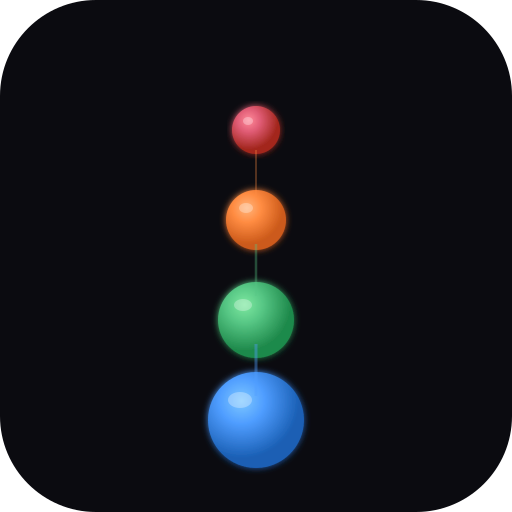

# GenGit3D

<p align="center">
  
</p>

3D git commit-graph visualizer. Parses `git log` into a graph (nodes = commits,
edges = parent→child, lanes = branches) and renders it with **three.js** +
OrbitControls.

Runs two ways: as a **standalone web viewer** (CLI + local server) and as a
**VS Code extension**. The only runtime dependency is `three`, vendored locally —
no CDN, no internet connection required.

## Install

### Standalone (CLI + web server)

```bash
npm install        # pulls three.js
```

### VS Code Extension

```bash
# 1. Install dependencies and build the extension + webview bundles
npm install
npm run build

# 2. Package as .vsix
npx vsce package

# 3. Install into VS Code
code --install-extension gengit3d-0.1.0.vsix --force
```

Or in debug mode: open this folder in VS Code and press `F5` (Extension
Development Host).

#### VS Code commands

| Command | Purpose |
|---------|---------|
| `GenGit3D: Open 3D Graph` | Opens the 3D graph of the current repo |
| `GenGit3D: File History in 3D Graph` | Opens the 3D graph scoped to the active file |

#### Where to find GenGit3D in VS Code

- **Activity Bar**: the **GenGit3D** icon in the left sidebar — opens a panel
  with *Open 3D Graph* / *File History* buttons.
- **Status bar**: `$(graph) GenGit3D` button at the bottom left (like GitGraph).
- **Source Control**: graph icon in the Git panel title bar.
- **Editor**: graph icon in the tab title bar, and right-click →
  *File History in 3D Graph*.
- **Explorer**: right-click a file or folder → *Open 3D Graph*.

#### VS Code configuration

```jsonc
{
  "gengit3d.defaultView": "topological",    // layout opened by default
  "gengit3d.defaultTheme": "neon",          // colour theme
  "gengit3d.maxCommits": 5000,              // commit limit
  "gengit3d.autoRotate": false,             // auto-rotate the scene
  "gengit3d.edgeOpacity": null,             // 0.05–1, null = theme default
  "gengit3d.nodeSize": null,                // 0.2–3, null = 100%
  "gengit3d.nodeSpacing": null              // 0.25–8, stretches the time axis only
}
```

## Usage

```bash
# 1) parse a repo into a graph.json (defaults to current dir)
node bin/gengit3d.js parse --repo /path/to/repo --out gengit3d.graph.json
node bin/gengit3d.js parse --max 200          # limit commits

# 2) serve the 3D viewer
node bin/gengit3d.js serve --port 8080

# or do both (parse current repo -> serve from this folder)
node bin/gengit3d.js
```

Open <http://localhost:8080/> — drag to rotate, scroll to zoom, hover a node for
commit info, click a node for the full commit panel.

### Viewer controls

The standalone page and the VS Code webview share most toolbar controls:

| Control | What it does | Where |
|---------|--------------|-------|
| `theme` | Colour theme (14 themes — dark + light) | both |
| `view` | 3D layout (6 modes — see below) | both |
| `colors` | Node colouring: `branch` palette, `author` hash hue, `age` (blue = old → orange = recent) | VS Code |
| `branch` / `author` selects | Isolate a single branch (or author, in `author` view) | VS Code |
| `fit ▸` | Animated camera framing: `visible`, `all`, `selection`, `top`, `front`, `side`, `iso` | both |
| `fx` | Post-processing, legibility-first: bloom, trails, antialias (FXAA), sharpen, vignette, contrast+, tilt-shift, depth of field (standalone: bloom/trails) | VS Code |
| `rotate` | Auto-rotate the scene | both |
| `labels` | Always-on labels for merges and tags (nearest ~24) | VS Code |
| `tips` | Branch tip cards — last commit of each branch (name + hash + subject); in the standalone page it also toggles stash/empty-branch tip markers | both |
| `edges` / `nodes` / `space` sliders | Edge opacity, commit-node size, and commit spacing along the time axis | VS Code |
| `⌂ fit` / `↻` / `⧉` | Quick re-frame / re-parse the repo / duplicate the panel in a new column | VS Code |
| `Branches` | Legend panel: search, per-branch checkboxes, click a name to solo it, `⎇` checkout on local branches, Top 10 (date filter in the standalone page) | both |

Animations: the camera **swoops in** on every load and view change, every fit is
an eased **fly-to**, the selection **pulses**, and the hovered commit gets a
breathing glow halo. `fx` persists across redraws and theme switches; bloom
strength is softened automatically on light themes.

### Reading the graph — shapes, weights, tips

- **Node shapes** carry the commit type: `●` normal commit, `◆` merge
  (octahedron), `▲` root (tetrahedron), `■` uncommitted changes (cube),
  `▶` stash (cone), `◇` empty-branch ref (torus).
- **Weight**: commits that touched many lines (`churn`) render bigger, and
  their incoming edge thicker — merge hubs read as heavier nodes.
- **Branch tips**: the last commit of every branch carries a card —
  `⎇ branch-name` (in the branch's colour) over `hash · subject`. Cards follow
  the camera (nearest ~32 shown), stack when several branches share a tip,
  hide with their branch's filter, and pop in when the movie reveals the tip.
- **HUDs**: bottom-left stats (visible/total commits · branches · edges) and a
  `now` line (checked-out branch, ↑ahead/↓behind upstream, dirty count, age of
  the last commit).

### The movie — history replay

The `▶` button on the scrub bar replays the repo's history as a film: commits
**pop in chronological order**, the camera **follows the playhead** (`cam`), and
the playback **dwells ~1.5 s on each commit** — enough to read its pinned card
(date — subject · author also shown in the subtitle line). The scrubber can be
dragged to any point, `speed` goes ¼×–4×, and the `from`/`to` date pickers (or
`[` `]` mark-in/out buttons) restrict the replay to a **period window**.

The movie respects **every active option**: hidden branches and authors are
skipped, and changing a filter or the period **while it plays** rebuilds the
stop list in place — it never dwells on an invisible commit.

## Architecture

```
git log --pretty=format:...  --topo-order
        │
        ▼
src/gitlog.js     → parseGitLog(): nodes/edges/branches + depth + real branch assignment
        │
        ▼
src/layout3d.js   → layoutGraphForView(): 6 layouts
        │
        ▼
src/scene.js      → three.js: spheres (branch-colored) + tube edges + OrbitControls
        │
        ▼
index.html        → importmap → vendor/three/, fetch graph.json, render
```

```
GenGit3D/
  package.json          extension manifest + build scripts (esbuild)
  bin/gengit3d.js       CLI (parse / serve / clean)
  src/gitlog.js         git log parser -> graph JSON (+ numstat churn, stash tips)
  src/layout3d.js       deterministic 3D layout dispatcher (6 views)
  src/scene.js          three.js scene (nodes/edges/OrbitControls/raycast/tooltip/tip labels)
  src/themes.js         14 light+dark themes (scene + HTML chrome)
  src/branch-colors.js  OKLab farthest-point color assignment
  src/similar-commits.js  similar-commit edge detection (cherry-picks, same subject)
  src/extension.ts      VS Code extension host (commands, webview panel, git calls)
  src/webview.ts        webview entry point (toolbar, legend, movie, detail panel)
  src/scene-webview.ts  webview scene (same features as scene.js + filters/fx/movie)
  index.html            standalone web viewer (importmap → vendor/three/)
  vendor/three/         vendored three.js r160 + addons (no CDN)
  test/                 vitest parser tests + fixtures + browser harness + shots
  entrypoint.sh         container entrypoint (parse then serve)
  Dockerfile            node:20-alpine + git
```

## Multiple views

6 display modes, selected via the `view` selector in the toolbar (or the
`?view=` API parameter). Each view reuses the same graph but changes the 3D
layout:

| View | Description | Layout |
|------|-------------|--------|
| `topological` | Heuristic branches (default) | Cylindrical, angle = branch |
| `chronological` | Pure timeline | Linear, x = date |
| `author` | Grouped by author | Cylindrical, angle = author |
| `radial` | Concentric circles by date | Radius = day |
| `queue` | Columns like `git log --graph` | x = branch, y = date |
| `real-branches` | Real git branches | Cylindrical, angle = real branch |

**Implementation** (`src/layout3d.js`): `layoutGraphForView(graph, view)`
dispatches to the matching layout function; each view mutates `node.x/y/z` in
place — so in the VS Code webview a view switch is a pure client-side re-layout
plus an animated camera move, no git re-parse needed.

The `real-branches` view reads actual git refs (`git rev-list` per ref; the
first ref — local before remote — that reaches a commit owns it) instead of a
BFS topology heuristic.

## Click a commit → details + timeline

**Timeline**: the axis is the **real commit date** (monotonic, oldest at one
end) when dates are available — dated ticks rendered via `CSS2DRenderer`.
Falls back to topological depth when dates are missing (`graph.axis.mode`).

**Click a commit** → detail panel:

| Block | Content |
|-------|---------|
| Header | short hash + subject |
| Meta | author, email, date, committer (if different), parents |
| Message | commit body |
| Stats | file count, `+added` / `-deleted` |
| Files | list with `+N/-N` per file |
| Diff | colourised patch (green additions, red deletions) |

A click is distinguished from an orbit drag (delta > 4 px ⇒ not a click). The
selected commit is wrapped in a pulsing halo and its sphere is enlarged ×1.7.
In the VS Code webview, selecting a commit also lights up a **hotspot**: the
~40 commits touching the same files stay bright while the rest of the graph
fades — useful for spotting related changes and cherry-picks.

## API

The server (`bin/gengit3d.js serve`) exposes:

| Route | Purpose |
|-------|---------|
| `GET /api/graph?repo=<path>&max=<n>&view=<v>` | parse a **local** repo on demand |
| `GET /api/clone?url=<git-url>&depth=<n>&max=<n>` | clone a **remote** repo (shallow if depth>0) then parse |
| `GET /api/repos?root=<dir>&depth=<n>` | list git repos under `root` (default `GENGIT3D_REPO`) |
| `GET /api/commit?repo=<path>&hash=<sha>&patch=1&maxPatch=<chars>` | metadata + files + optional patch |

```bash
curl "http://localhost:8083/api/graph?repo=/repo&view=chronological"
curl "http://localhost:8083/api/clone?url=https://github.com/octocat/Hello-World.git&depth=50"
curl "http://localhost:8083/api/commit?repo=/repo&hash=<sha>&maxPatch=2000"
```

- `hash` is validated (`^[0-9a-f]{4,40}$`) — no git argument injection.
- The patch is **truncated** (`maxPatch`, default 60 000 chars, cap 400 000) and
  `patchTruncated` flags it.
- `git show -s --format=%P` is queried **separately** from `%b`: the message
  body can break a naive split.
- Merge commits: `--numstat` may be empty → "(no files — merge commit?)".
- Clone safety: only `https:// git:// ssh:// git@host: file://` schemes are
  accepted.

## Themes (light + dark)

Fourteen themes in `src/themes.js` (`theme` selector in the toolbar; the
standalone page persists the choice in `localStorage`). Each theme controls
**both** the three.js scene (background, fog, palette, lights, long-tail
recede) **and** the HTML chrome (CSS variables).

| Key | Type | Background |
|-----|------|------------|
| `neon` | dark | `#06060a` (default) |
| `midnight` | dark | `#0b0b10` |
| `slate` | dark | `#141a24` |
| `tokyo` | dark | `#1a1b26` |
| `dracula` | dark | `#282a36` |
| `nord` | dark | `#2e3440` |
| `catppuccin` | dark | `#1e1e2e` |
| `gruvbox` | dark | `#282828` |
| `ocean` | dark | `#0b1622` |
| `matrix` | dark | `#020a02` |
| `mono` | dark | `#101014` |
| `daylight` | light | `#eef2f8` |
| `paper` | light | `#f6f1e7` |
| `solarized` | light | `#fdf6e3` |

**Readability rule** — on a **light** background, two traps make the graph
unreadable; both are handled in `themes.js`:

1. **The fog must converge to a MID tone, not the pale background.** Otherwise
   distant strands lighten toward white and vanish. Hence a `fogColor` field
   distinct from `background` on light themes (`0x6b7688` for `daylight`).
2. **The long tail recedes toward a mid grey** (darker than the background), not
   a pale tint: `recede: 0x55606f`, `recedeAmount: 0.45`.

Adding a theme = one entry in `THEMES`; the `<select>` and the chrome follow.

## Branch & author filtering

The legend panel filters branches by name (search), by checkbox, and by date
range (standalone page); clicking a branch name **solos** it, and local
branches show a `⎇` checkout button. In `author` view the same panel switches
to per-author filtering. Hidden branches drop to 0.1 opacity (standalone) or
scale-0 (webview) — edges between two visible nodes stay visible.

Filters are live: they re-tint the scene, shrink the stats to "visible / total",
hide the matching branch-tip cards, and **rebuild the movie's stop list** when
it is playing.

## Stash + empty-branch tips

Stash commits and empty branches are shown as synthetic nodes with dashed
edges — cone (stash) and torus (empty branch) shapes — plus the same branch-tip
card as regular branches.

## Any repo

Type a local path or a git URL in the standalone UI — no CLI restart needed.

## Docker

```bash
docker build -t gengit3d:latest .
# mount a repo so the graph is generated at startup:
docker run -d --name gengit3d -p 8083:8080 \
  -v /path/to/repo:/repo:ro gengit3d:latest
# → http://localhost:8083/
```

- `node:20-alpine` + `git` (required to run `git log` — without git,
  `parse`/`start` crash with `spawn git ENOENT`).
- **`gengit3d.graph.json` is gitignored** (generated artefact ~7 MB). The
  `entrypoint.sh` generates it at startup from the mounted repo, then runs
  `serve` → a clean checkout works with no committed graph file.
- Entrypoint environment variables:

  | Var | Default | Role |
  |-----|---------|------|
  | `GENGIT3D_REPO` | `/repo` | repo to parse at startup |
  | `GENGIT3D_OUT` | `/app/gengit3d.graph.json` | generated graph path |
  | `GENGIT3D_PARSE` | `1` | `0` = skip parsing (serve the existing graph) |
  | `GENGIT3D_MAX` | `0` | commit limit (`0` = all) |
  | `PORT` | `8080` | HTTP port |

- `HEALTHCHECK`: probes `GET /gengit3d.graph.json` (healthy only when a graph is
  actually served, not just the HTML shell).

## Notes / limitations

- three.js is **vendored locally** in `vendor/three/` — no CDN or internet
  connection required.
- `relax()` (force relaxation pass) is optional and disabled by default.
- `index.html` does a `fetch('./gengit3d.graph.json')` → you need an HTTP server
  (not `file://`).
- Post-processing (`fx`) is built lazily — `none` keeps the plain render path.

## Security

The HTTP API is designed to be safe by default:

| Measure | Default | Override |
|---------|---------|----------|
| Listen address | `127.0.0.1` (loopback only) | `GENGIT3D_HOST=0.0.0.0` |
| Clone URL schemes | `https://` only | `GENGIT3D_ALLOW_ALL_SCHEMES=1` |
| Repo path allowlist | (disabled — all local paths allowed) | `GENGIT3D_REPO_ALLOWLIST=/repos,/home/user/projects` |
| Max clone size | 500 MB | `GENGIT3D_MAX_CLONE_SIZE=<bytes>` |
| Clone timeout | 5 minutes | `GENGIT3D_CLONE_TIMEOUT=<ms>` |
| Clone auto-cleanup | 1 hour | `GENGIT3D_CLONE_TTL=<ms>` |

- Git option injection is prevented by passing `--` before the URL in `git clone`.
- Clone failures are cleaned up immediately; successful clones are removed after TTL.
- The `?hash=` parameter is validated against `^[0-9a-fA-F]{4,40}$` before any git command.

## Testing

```bash
npm test     # vitest unit tests on parser fixtures (test/parser.test.js)
```

Tests cover: simple histories, merge commits, multiline messages, special
characters in author names, branching histories, and empty input.

`test/harness.html` runs the **real built webview bundle** (`dist/webview.js`)
in a plain browser against `test/graph-data.js` — serve the folder and open it
to check the full UI without VS Code (`?seq=<name>` triggers scripted
scenarios; `test/shots/` keeps reference screenshots).

## Performance

GenGit3D uses `InstancedMesh` for nodes and edges, keeping draw calls flat
regardless of graph size — the webview renders one instanced mesh **per node
shape** (≤ 6: sphere / octahedron / tetrahedron / cube / cone / torus), and the
standalone viewer keeps a visible + ghosted pair. For large repositories, the
geometry complexity is automatically reduced (standalone viewer):

| Graph size | Sphere segments | Cylinder segments |
|------------|-----------------|-------------------|
| ≤ 5 000 | 14 × 12 | 6 |
| 5 001 – 20 000 | 10 × 8 | 6 |
| > 20 000 | 8 × 6 | 4 |

Benchmarks on a 2024 M2 MacBook Air (Safari, 1440×900 viewport):

| Commits | Nodes | Edges | FPS (midnight) | FPS (daylight) |
|---------|-------|-------|----------------|----------------|
| 1 000 | 1 000 | 999 | 60 | 60 |
| 10 000 | 10 000 | 9 999 | 58 | 55 |
| 50 000 | 50 000 | 49 999 | 42 | 38 |
| 100 000 | 100 000 | 99 999 | 28 | 25 |

> Benchmarks are indicative. Actual FPS depends on GPU, browser, and theme.
> The `midnight` theme is slightly faster due to lower fog density.
> `fx: bloom`/`trails` add a constant fullscreen pass cost per frame.

For very large repositories, use `?max=<n>` to limit the number of commits parsed.

## License

MIT — see [LICENSE](LICENSE) for details.
